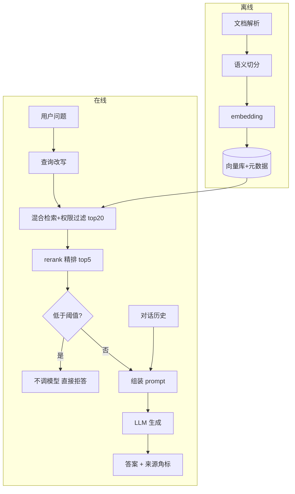

---
tags:
  - 概念卡
type: concept
domain: AI
topic: RAG
status: 需复习 # 学习中 / 已理解 / 已考核 / 需复习
created: 2026-09-10
source: ""
---

# RAG 全链路

## 一句话定义
> RAG（Retrieval-Augmented Generation，检索增强生成）= 用户提问时先从知识库里检索出相关文档片段，再把片段塞进 prompt 让模型"开卷考试"，基于检索内容生成带来源的答案；解决模型知识过时、无企业私有数据、幻觉和上下文装不下全量文档的问题。

## 为什么需要
- 解决的问题：模型不知道企业私有文档；模型训练数据有截止日期；直接问答会幻觉；全量文档塞不进上下文窗口。
- 没有它会怎样：问答只能靠模型参数记忆（过时/编造/无出处），或全量塞文档导致超窗口、高成本、lost in the middle。

## 原理 / 流程

**离线链路（构建/增量更新）**
1. 文档解析：PDF/Word/飞书/网页 → 文本 + 结构（标题层级、表格）。
2. 切分 chunking：按语义边界（标题/段落）切，非固定字符；chunk 间留 overlap。
3. 向量化：每个 chunk 过 embedding 模型。
4. 入库：向量 + 原文 + 元数据（来源、页码、ACL（Access Control List，访问控制列表）权限）写入向量库。

**在线链路（每次提问）**
1. 查询改写（可选）：消解多轮指代/省略（"那它多少钱" → "iPhone 16 价格"）。
2. 粗检索：问题向量化 → 混合检索（向量语义 + BM25 关键词，RRF 融合；BM25 = Best Matching 25，关键词排序算法；RRF = Reciprocal Rank Fusion，倒数排名融合）→ 元数据权限过滤 → top-20。
3. rerank（重排序）精排：用 cross-encoder（交叉编码器，把问题和文档拼在一起送入模型打分的精排模型）对粗排结果逐一打分取 top-5（粗排快而粗保召回，精排慢而准保准确）。
4. 阈值门（确定性兜底）：候选分数全部低于 similarity threshold → **不调用模型**，直接返回"未找到相关资料"，请求在此短路。
5. 组装 prompt：system 约束 + 带来源标注的 chunks + 历史 + 问题；硬约束"只依据资料、不足就说不知道、禁止编造"。
6. 生成：流式输出（SSE，Server-Sent Events，服务器推送事件，模型边生成前端边渲染）。
7. 溯源：答案标注引用 chunk（角标 + 来源链接）。

## 深度解析：双塔 vs 交叉编码（rerank 为什么准）
- **query**：用户实时输入的查询（每次提问只有 1 条）；**doc**：知识库中被搜索的 chunk（离线准备好，几万~几百万条）。检索 = 从海量 doc 中找与 query 最相关的几条。
- **双塔编码（bi-encoder / dual-encoder，双编码器，粗排）**：query 和 doc 分别通过两座独立模型塔编码成向量，互不见面，最后只算余弦距离。doc 向量可离线预计算，在线只需 1 次 query 编码 + ANN（近似最近邻）索引搜索，毫秒级；但长文档被压缩成单个向量、细节丢失，模型编码 doc 时不知道 query 是什么，只能产出"通用语义摘要"。
- **交叉编码（cross-encoder，交叉编码器，精排）**：query 和 doc 用 [SEP]（separator，分隔符）拼成一整段送入同一模型，attention（注意力机制）让 query 每个词看到 doc 每个词，输出相关度得分。带问题精读、词级匹配，准；但 doc 无法预计算（query 一变整条输入就变），N 条候选 = N 次完整在线推理，只能对粗排结果做。
- **配合**：全库 → 双塔粗排 top-20（保召回率 recall，宁可错召不可漏）→ 交叉编码精排 top-5（保精确率 precision，少而准）→ 塞进 prompt。

## 深度解析：本轮未掌握的四条（2026-10-12 补）

**① 检索侧阈值拒答，为什么不能只靠 prompt 硬约束**
`必须只基于 <context> 回答` 是求模型自觉，模型经常不自觉——"看着相关但资料里没有"的问题它会长篇编造（部分正确的答案最难发现）。阈值是代码里的确定性判断，不依赖模型守规矩，附带省一次调用成本和首字延迟。两者是不同层的兜底，不是替代关系。

**② RRF 为什么不能把两路分数直接相加**
两路分数量纲不可比（score incomparability）：余弦相似度有界 0~1，BM25 无上界（取决于词频、文档长度、IDF，能到 20~30）。直接相加 = 谁量级大谁独裁，混合检索退化成纯关键词检索；且两路各自返回的 top-k 是不同文档集合，很多文档只有一路有分。
RRF 丢掉分数只用名次：`score(doc) = Σ 每一路 1/(k + rank_i)`，k 取 60 做平滑。名次天然归一化，无需知道各路分数含义、无需调权重。代价：抹平了第 1 名和第 2 名之间的实际差距。

**③ overlap 在防什么具体事故**
制度原文连续："……满 1 年享有 5 天年假。**其中 3 天需提前两周申请，逾期视为放弃。**" 不留 overlap 硬切成两块后，关键词全在前一块 → 只召回前一块 → 模型答得出天数、答不出怎么请，然后自行编一套申请流程。overlap 让后块的开头重复附到前块尾部，任一命中都自带上下文。固定字符切分还会把表格/代码块从中间劈开，结构和语义一起废——所以先按标题/段落等语义边界切，再对超长块二次切并留 overlap。代价：索引体积与 embedding 计算量上升；同一段文字进多个 chunk，可能霸榜 top-k，需按 doc_id 去重。

**④ 中文必须显式分词**
`[^\p{L}\p{N}]+` 里 `\p{L}` 包含汉字，而中文词之间没有空格 → 整句话成为一个 token → 检索退化成整句字面匹配，同义改写相似度归零。这是 Demo 04 误拒的根因，也是"哈希词袋 ≠ 语义 embedding"最直接的证据。

## 生产链路 vs Demo 04 对照（2026-10-12，防再次混讲）
| 环节 | Demo 04 实际 | 档位 |
| --- | --- | --- |
| 文档解析 | 只 `readFile` 一个 Markdown | 缺 |
| 语义切分 + overlap | `split(/\n(?=## )/g)` 按 `##` 标题切，**无 overlap**、长段落不二次切 | 玩具版 |
| 向量化 | 哈希词袋（128 维 + L2 归一化），无分词 | 玩具版 |
| 混合检索（向量+BM25+RRF）/ 权限过滤 / 向量库 | 只有余弦相似度全量线性扫描 | 缺 |
| rerank 精排 | 无 | 缺 |
| 阈值拒答 | `retrieve(q, index, 3)` 用默认 `minScore = 0`，过滤 `score > 0` | 玩具版，且双向失效 |
| 查询改写 | 无（只用最后一条 user 文本检索；历史仍完整传给模型） | 缺 |
| 溯源展示 | `formatContext` 打 `[1] 来源:` 编号 + system 要求列来源 | **已实现** |

`minScore = 0` 的双向失效：拦不住哈希碰撞的假命中（相似度极低也算命中，无关 chunk 进 prompt）；又拦不住真问题被误拒（中文整句成一个 token，与库内 token 字面相同时概率很小，多数中文提问直接落到拒答分支）。**误拒比例尚未实机测出，属代码推断。**

## 前端视角类比
- 离线索引 ≈ 构建期预计算（SSG）；在线检索 ≈ 请求时查库（SSR 取数）。
- 粗排 + rerank ≈ 搜索结果的粗筛 + 二次精排（性能与精度分层）。
- prompt 组装 ≈ 拼 HTML 模板：模型是模板引擎，检索结果是数据。
- 溯源角标 ≈ 引用链接。

## 关键 API / 参数
| 名称 | 作用 | 注意点 / 默认值 |
| --- | --- | --- |
| chunk size / overlap | 切分粒度 | 常用 300~800 token + 10% overlap；按文档结构调整 |
| 粗排 top-k | 召回数 | 20 左右，宁多勿漏 |
| rerank top-n | 精排后保留数 | 3~5，喂给生成 |
| similarity threshold | 相关度阈值 | 必须显式传值；默认 0 / `score > 0` 等于没设阈值：既拦不住哈希碰撞的假命中，也拦不住低相关噪声 |
| cross-encoder | rerank 模型 | 查询与文档拼接过模型，准但贵；不用于全库检索 |

## 踩过的坑
- [ ] 固定字符硬切 → 表格/代码块/语义被腰斩（按结构切 + overlap）
- [ ] 多轮指代不处理 → 用"那它呢"直接检索，向量全偏（加查询改写）
- [ ] 检索后才做权限过滤 → 召回缺口 + 数据出库（filter 下推，见 [[Embedding 与向量检索]]）
- [ ] 只做粗排不 rerank → 相关片段排在 20 名外没进 prompt
- [ ] 不设相关度阈值 → 知识库里没有也强行编造答案
- [ ] 文档更新后向量不重建 → 答案引用过期制度（需要增量索引/版本管理）
- [ ] 把哈希词袋当语义 embedding → 它只认字面，不懂同义（"年假怎么请" ≠ "休假申请流程"）
- [ ] 中文没做分词就 tokenize → 整句成为一个 token，字面不重叠就相似度归零，可答的问题被误拒
- [ ] 不留 overlap → 条件在前一段、例外在后一段，答案只对一半（最难发现的缺陷）

## 面试追问
- **Q：为什么要粗排 + rerank 两阶段？**
  **A：** 向量检索是双塔编码（query/doc 各自编码算距离），快但粗，适合全库粗召回；rerank 是 cross-encoder（query 和 doc 拼接一起过模型），准但计算贵，只对粗排的 20 条做。粗排保召回率，精排保准确率，是成本与效果的分层。
- **Q：RAG 能消灭幻觉吗？**
  **A：** 不能，只能显著降低。还要：prompt 硬约束"无依据说不知道"、相关度阈值兜底、引用一致性校验、eval 集回归评测。
- **Q：RAG 和微调（fine-tuning）怎么选？**
  **A：** 知识类/频繁更新/要溯源 → RAG；风格/格式/固定技能（输出语气、领域表达模式）→ 微调（fine-tuning，在模型参数上继续训练）；二者可叠加。RAG 改数据即可，微调要重训。
- **Q：怎么评估 RAG 效果？**
  **A：** 拆两段评：检索质量（召回率/命中率/MRR（Mean Reciprocal Rank，平均倒数排名，衡量正确结果在排序列表中位置的指标），看正确 chunk 是否进 top-k）+ 生成质量（答案正确性、引用忠实度、拒答合理性），建标注 eval 集做回归。详见 [[RAG 应用评估]]。

## 关联
- 上位概念：[[LLM 核心心智模型]]
- 相关概念：[[Embedding 与向量检索]]、[[Function Calling]]、[[对话消息结构]]、[[RAG 应用评估]]、[[结构化输出与 Schema 校验]]
- 项目实践：[[04 RAG Minimal Demo]]

## 费曼问答记录
- Q: 员工上传/更新文档后，离线做哪几件事？
  A: 文档解析（PDF/Word → 文本+结构）→ 语义切分（chunking，按标题/段落，留 overlap）→ embedding 向量化 → 入库（向量 + 原文 + 元数据：来源、页码、ACL 权限）。
- Q: 员工提问后，在线经过哪些环节才返回答案？
  A: 查询改写（可选，消解多轮指代）→ 混合检索（向量+BM25，元数据权限过滤）→ 粗召回 top-20 → rerank（重排序）精排 top-5 → 组装 prompt（system 约束 + 带来源标注的 chunks + 历史 + 问题）→ 模型流式生成 → 溯源标注。
- Q: 为什么检索要分"粗排 top-20 + rerank 精排 top-5"两步？
  A: 粗排是双塔编码（query 和 doc 各自算向量距离），快但粗，适合全库召回；精排是 cross-encoder（交叉编码器，query 和 doc 拼接后完整过模型打分），准但贵，只对粗排结果做。粗排保召回率，精排保准确率。
- Q: 第二轮问"那这个制度和去年有什么区别"——直接拿这句话去检索会有什么问题？怎么办？
  A: "那"和"这个"是省略指代，向量库里搜不到。需要查询改写（query rewriting）：用 LLM 把多轮依赖消解为独立查询，如"2025 年考勤制度 与 2024 年考勤制度 区别"。
- Q: 知识库里没有相关文档，系统却返回了编造答案——在哪个环节、用什么手段兜底？
  A: 三层兜底：prompt 硬约束"不足就说不知道"、相关度阈值（similarity threshold，相似度低于阈值直接拒答）、答案与引用一致性校验。
## 费曼问答记录（复习轮）
- Q（2026-09-14 复习）：完整复述离线/在线链路 + 双塔 vs 交叉编码。
  A: 通过。离线：文档解析 → 语义切分（留 overlap）→ embedding → 入库（向量+原文+元数据）；在线：查询改写 → 混合检索（向量+BM25+权限 filter 下推）→ 双塔粗排 top-20 → 交叉编码 rerank 精排 top-5 → prompt 组装 → 流式生成 → 溯源。双塔独立编码算距离、doc 可预计算故快但粗；交叉编码 query/doc 用 [SEP] 拼接过模型、attention 词级交互故准但无法预计算。唯一措辞提醒：离线要显式区分"文档解析"与"切分"两个得分点。

## 费曼问答记录（Demo 04 实践验收）
- Q（2026-09-28）：在 Demo 04 中，用户提问后从检索到生成答案的完整链路是什么？无命中分支在哪里提前结束？
  A: 服务启动时，`buildIndex` 读取 Markdown，按二级标题切成 chunks，用教学用哈希词袋生成归一化向量并保存在内存。用户提问后，`/api/chat` 提取最后一条用户文本；`retrieve` 用同一算法生成问题向量，逐个计算余弦相似度，按分数降序排序，过滤 `score <= minScore` 的结果并截取 top-k。若结果为空，服务端直接写入固定拒答的 UIMessage 流并返回，不调用模型；若命中，则 `formatContext` 将 chunk 原文、标题和来源组装进 `<context>`，再由 `streamText` 调用模型生成答案，前端渲染流式文本及来源标注。当前 Demo 没有查询改写、真实语义 embedding、向量数据库、混合检索或 rerank。
- 本次卡点：只回答了“改写代指词、embedding 语义检索、返回引用”三个概括词；把生产级可选的查询改写误认为 Demo 已实现；把教学用哈希词袋误认为语义 embedding；遗漏建索引、余弦相似度、top-k、阈值拒答、上下文组装、模型流式生成和无命中短路。

## 费曼问答记录（复习轮 2026-10-12）
- Q: 生产级离线 + 在线全链路，每步名字 + 解决什么问题。
  A: **通过（8/10）**。离线：文档解析 → 语义切分（留 overlap）→ embedding → 入库（向量+原文+元数据含 ACL）。在线：查询改写 → 混合检索（向量+BM25+RRF，权限 filter 下推）top-20 → cross-encoder rerank top-5 → prompt 组装 → 流式生成 → 溯源。顺序、分段、权限过滤位置全对；扣分在只给步骤名、几乎没给"为什么"，且漏了检索侧阈值拒答。
- Q（未掌握，已补答案）: 在线链路漏了哪个环节？
  A: 相似度阈值拒答（similarity threshold）。在 rerank 打分之后、返回 top-k 之前做确定性过滤，候选为空则**不调模型**直接返回"未找到"。它和 prompt 硬约束是两层兜底，不能互相替代。
- Q（未掌握，已补答案）: 向量分数和 BM25 分数为什么不能相加？RRF 拿什么在算？
  A: 量纲不可比（余弦 0~1 有界 vs BM25 无上界），相加会被大量级一方独裁，混合检索退化成纯关键词检索；两路 top-k 还是不同文档集合。RRF 只用名次：`Σ 1/(k + rank)`，k=60，天然归一化；代价是抹平分数差距。
- Q（未掌握，已补答案）: overlap 防什么事故？举一个不留就出问题的例子。
  A: "5 天年假" 和 "需提前两周申请" 被切到相邻两块，关键词全在第一块 → 只召回第一块 → 答对天数、答不出流程并自行编造。见上方「深度解析③」。
- Q（未通过）: Demo 04 六个环节各自是"已实现 / 玩具版 / 缺失"哪一档？
  A: 只回了一个字母 "B"，未定位环节，无法验收。完整对照见上方「生产链路 vs Demo 04 对照」表。
- Q（未掌握 + 概念串线）: `embedText` 遇到"年假怎么请"和"休假申请流程"会怎样？
  A: 两句都检索不到"请假制度"chunk，相似度≈0。根因是**没有中文分词**（整句成一个 token），不是"丢失语义边界"——后者属于切分环节，答题时串线了。
- 待考：Q3 双塔 vs cross-encoder 为什么不能反过来用（本轮未答，下次先补）。

## 费曼验收
- [ ] 不看笔记能给外行讲清楚（2026-10-12：链路复述通过，但只讲得出"是什么"、讲不出"为什么"——overlap / RRF / 阈值拒答三处当场答不上）
- [ ] 能把每个环节正确标档为「已实现 / 玩具版 / 缺失」，不把自己的 Demo 说成生产级（2026-10-12 未通过，仍混讲）
- [ ] 能徒手写出最小可运行 demo（Demo 04 是在给定骨架上填空完成，不算徒手；待闭卷重写验收）
- [ ] 模拟面试中能答出追问（2026-10-12 Q3 双塔 vs cross-encoder 未答，待考）
