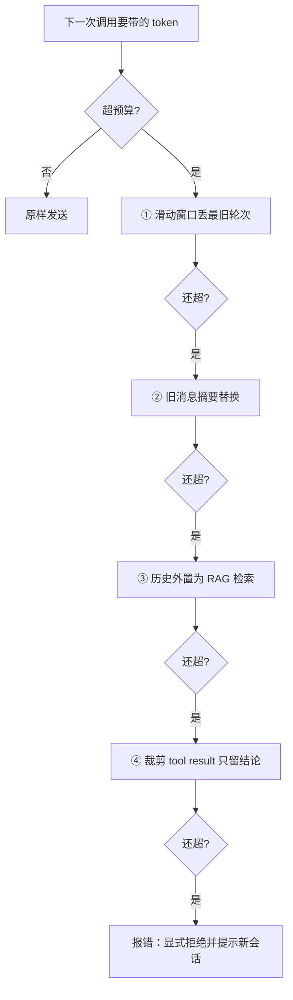

---
tags:
  - 概念卡
type: concept
domain: AI
topic: 上下文工程
status: 学习中 # 学习中 / 已理解 / 已考核 / 需复习
created: 2026-10-14
source: ""
---

# 上下文管理与窗口预算

## 一句话定义
> 上下文窗口（context window，一次调用能容纳的输入 + 输出 token 上限）是每次请求的**输入预算**：因为模型无状态、每轮全量重发，"上下文管理"就是决定这一次带哪些 token、花多少 input 成本、以及怎么让稳定前缀命中缓存。

## 为什么需要
- 解决的问题 1（硬上限）：超出窗口直接报错或截断，不是"降级"而是"失败"。
- 解决的问题 2（成本曲线）：第 k 轮要重发前 k−1 轮历史，累计 input token ≈ Σ(前缀长度)，**随轮数呈平方级增长**。这是应用方设计出来的成本，不是模型定的。
- 解决的问题 3（Agent 膨胀最快）：每一步的 `tool result` 都留在上下文里，5 步工具调用可能让 input 翻一个数量级。
- 解决的问题 4（注意力稀释）：窗口能塞满 ≠ 该塞满。上下文越长，模型对其中单条信息的利用率越低（"海里找针"效应）；这正是 RAG 里 top-k 小 + rerank 存在的前提，而不是"反正窗口大就全塞"。

## 原理 / 流程
1. **预算分段**（一次调用的输入构成，从稳定到易变）：
   `稳定前缀（system + tools 声明 + few-shot）` → `半稳定（检索到的 chunk）` → `动态（对话历史 + 当前问题）` → 另外要**预留输出空间**（`maxOutputTokens`）。
2. **计数口径**：本地估算只用于"要不要裁剪"的决策；真实值以 API 返回的 `usage`（OpenAI 兼容里是 `prompt_tokens` / `completion_tokens`，AI SDK 里是 `inputTokens` / `outputTokens`）为准。分词器各家不同，中文估算偏差尤其大（见 [[LLM 核心心智模型]] 的 token 口径）。
3. **超窗四档降级**（从轻到重）：
   ① 滑动窗口（丢最旧轮次）② 摘要替换（旧消息让模型压成一条 summary 再顶上去）③ 外置记忆（历史向量化，按相关性检索回来）④ 工具结果裁剪（只留结论或引用 id，不留原始返回）。
4. **前缀缓存**：把不变内容放最前、易变放最后。缓存命中要求前缀**逐字节一致**（官方：exact prefix match required），前缀里改一个字符，它之后的缓存全部失效；写缓存收溢价、读缓存打折，所以"只复用一次的内容"放进缓存是赔钱的。（"中途换模型必 miss"是社区口径，本次官方页没直接确认，见「待核实」。）
5. **重试也进预算**：任何重试（如 `maxRetries`）都会把同一份 input 再发一遍，token 照样计（`maxRetries` 覆盖范围见 [[结构化输出与 Schema 校验]] 的「待核实」）。

## 前端视角类比
- 类比：（留白，你自己填）
- 引导问题 1：缓存要求"前缀逐字节一致"，和你在浏览器缓存 / Vite 打包里做的哪件事同构？为什么打包要把 vendor chunk 和业务 chunk 拆开、并且给内容 chunk 加 hash 名？这和 system prompt / 历史消息的排列顺序是不是同一个设计决策？
- 引导问题 2：input token 随轮数平方增长，对应前端哪一类性能陷阱？（提示：每次更新都把全量 state 重传 / 无 diff 的全量刷新）
- 引导问题 3：滑动窗口丢上下文 vs 摘要压缩丢细节——这两个取舍分别像缓存策略里的 LRU 和什么？你在做列表虚拟滚动时是怎么决定"保留多少"的？

## 关键 API / 参数
| 名称 | 作用 | 注意点 / 默认值 |
| --- | --- | --- |
| 模型上下文窗口 | 输入 + 输出总上限 | 以官方模型页为准，且各家口径不同（有的只算输入）；不要把它当"可用输入预算"，要减去输出预留 |
| `maxOutputTokens`（AI SDK）/ `max_tokens`（OpenAI 兼容） | 预留输出空间 | 不设也可能被模型默认上限截断，表现为 `finish_reason: 'length'`；历史挤满时输出被腰斩 |
| `usage` / `prompt_tokens` / `inputTokens` | 真实 token 消耗 | 计费与优化都以它为准，本地估算仅供决策 |
| `tools` 声明 | 每次请求全量重发函数名 + JSON Schema | 这部分计入 input token；工具越多、schema 越长，固定开销越大 |
| `cache_control: { type: 'ephemeral' }` | 显式把缓存断点打在稳定前缀末尾 | Anthropic 官方口径已核：写 1.25 倍（5 分钟 TTL）/ 2 倍（1 小时 TTL），读 0.1 倍，默认 TTL 5 分钟，**最小可缓存长度随模型不同**，前缀必须完全一致（exact prefix match） |
| 自动前缀缓存 | 无需标记，服务端自动复用稳定前缀 | OpenAI 系确为自动缓存、有最小可缓存前缀门槛；**但本次从官方页拿到的门槛与倍率数字内部不自洽（疑似混入 Anthropic 口径），故不写成结论**，用之前人肉复核定价页 |
| `abortSignal` | 客户端中断生成 | 已发送的 input 已计费，中断只省下未生成的输出（见 [[流式响应与 AI 原生交互]]） |

## 踩过的坑
- [ ] 在 system 开头放了时间戳 / request id / 随机用户名 → 每次前缀都不同，缓存 100% miss，账单和延迟一起变差
- [ ] 把模型标称窗口当成可用预算，没扣 `maxOutputTokens` 预留 → 报 context length exceeded，或输出被截断成半句话
- [ ] 觉得"反正窗口 200K"就一次塞 30 个 chunk → 检索精度没上去，模型抓错依据（正确做法是 top-k 小 + rerank + 阈值门）
- [ ] Agent 多轮里 `tool result` 原始返回全量留在上下文 → 第 5 步之后 input 膨胀十倍，应只回传裁剪后的结论
- [ ] 用本地估算 token 做计费/预算依据 → 分词器不同、中文偏差大，估算只用于触发裁剪，落账看 `usage`
- [ ] （口径待核实）中途换模型/换供应商指望复用缓存 → 社区普遍说缓存绑定模型会全量 miss，官方页我这次没直接核到，实测前别当确定事实讲
- [ ] 摘要压缩时把 `tool_call` 和它的 `tool_result` 拆开了 → 出现孤立的工具结果，历史结构非法，直接报错
- [ ] 只有"丢了最旧一轮"这种硬截断，没有分级降级 → 关键约束（比如用户早先说的预算上限）被静默丢弃，模型前后矛盾

## 面试追问
- **Q：** 多轮对话的 input 成本为什么是平方级增长？写出估算式，并给出三种把曲线压回接近线性的手段。
  **A：** TODO（自己答）
- **Q：** prompt caching 的命中率由什么决定？为什么往 system 里加一个时间戳能让整轮全部 miss？
  **A：** TODO（自己答）
- **Q：** 200K 窗口的模型，什么时候该直接长上下文、什么时候仍然要做 RAG？分界线是什么？
  **A：** TODO（自己答）
- **Q：** Agent 跑到第 10 步 input 爆了，给一个分层方案，并说明每层丢的是什么。
  **A：** TODO（自己答）

## 关联
- 上位概念：[[LLM 核心心智模型]]
- 相关概念：[[对话消息结构]]、[[Function Calling]]、[[Agent 与 MCP]]、[[RAG 全链路]]、[[流式响应与 AI 原生交互]]、[[Prompt 工程与指令遵循]]
- 项目实践：[[03 Agent 与 MCP Demo]]、[[04 RAG Minimal Demo]]

## 待核实
- AI SDK 是否提供官方消息裁剪/修剪工具函数我**没有核实到**：本地 `demos/*/node_modules` 不存在（依赖未安装），无法从类型定义确认，社区检索到的 `trim_messages` / `history_processors` 属于 LangChain / pydantic-ai 而非 AI SDK。当前可确定路径是自己写 history 处理函数。
- **已用官方页核到的**：Anthropic 的 1.25x / 2x / 0.1x / 默认 5 分钟 TTL / 前缀需完全一致 / 最小可缓存长度随模型不同 / `cache_control: {type: "ephemeral"}` 写法。
- **没核到、别当事实讲的**：① "缓存绑定模型，换模型必 miss"（社区口径）；② "命中会自动续期 TTL"（社区口径，官方页本次未确认）；③ OpenAI 的最小 token 门槛与折扣倍率（检索结果内部不自洽）；④ **DeepSeek 到底有没有自动前缀缓存、命中怎么计价**——这条直接决定你 Demo 04 的成本结构，最稳的办法是实机打两次同样的长 system，比对响应 `usage` 里有没有 cached / prompt_tokens_details 字段。
- 具体模型的窗口大小与输出上限不要背数字，以模型页为准。

## 费曼问答记录
<!-- 每次费曼验收的题目和正确答案追加到此，格式：Q: / A: -->

## 费曼验收
- [ ] 不看笔记能给外行讲清楚
- [ ] 能徒手写出最小可运行 demo
- [ ] 模拟面试中能答出追问
