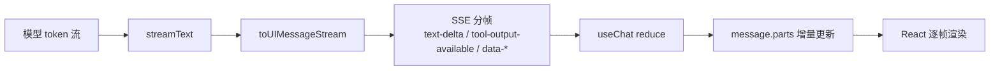
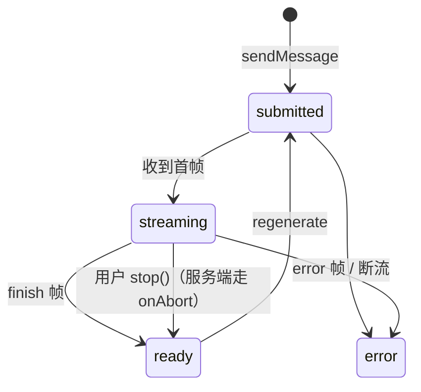

---
tags:
  - 概念卡
type: concept
domain: AI
topic: AI 原生交互
status: 学习中 # 学习中 / 已理解 / 已考核 / 需复习
created: 2026-10-14
source: ""
---

# 流式响应与 AI 原生交互

## 一句话定义
> 流式响应（streaming，流式传输）= 模型的 token 不是一个字符串返回，而是通过 HTTP 长连接逐帧推送，客户端把帧流**折叠（reduce）成一条带 parts 的 UIMessage** 并增量渲染；AI 原生交互 = 围绕"生成过程可见、可中断、可修正"重新设计 UI，而不是等完整结果再画。

## 为什么需要
- 解决的问题 1（感知延迟）：一次长生成全量返回要等 10s+，而**首 token 时间（TTFT，Time To First Token）**通常 <1s。流式把"等待"变成"看见进度"，这是纯体感问题，不是性能问题（总耗时没变）。
- 解决的问题 2（接口形态）：模型侧本来就是 token 流（OpenAI 兼容接口 `stream: true`），非流式等于主动丢弃了增量信息。
- 解决的问题 3（过程可见）：Function Calling / Agent 让"一次回答"变成多步（思考 → 调工具 → 再思考）。不流式，用户面对 5 秒空白，以为系统挂了。
- 解决的问题 4（控制权与成本）：流式才有"停止生成"这个交互，也就有了中断权 → 成本可控 + 用户可以换方向。

## 原理 / 流程
1. 服务端：`streamText(...)` → `result.toUIMessageStream()` → `pipeUIMessageStreamToResponse({ stream, response })`（Demo 04 `server/index.ts` 已是这条）。
2. 传输形态：SSE，一行一帧 `data: {...}`，例如 `data: {"type":"text-delta","id":"t1","delta":"你好"}`；流末尾以 `data: [DONE]` 收尾，响应头带 `x-vercel-ai-ui-message-stream: v1`（官方 stream-protocol 页口径）。
3. 帧类型（UI message stream chunk，UI 消息流分片）：`start` / `start-step` / `text-start` / `text-delta` / `text-end` / `reasoning-start` / `reasoning-delta` / `reasoning-end` / `tool-input-start` / `tool-input-delta` / `tool-input-available` / `tool-output-available` / `tool-approval-request` / `tool-approval-response` / `data-*` / `file` / `source-url` / `error` / `finish-step` / `abort` / `finish`。
   （注意：`tool-call` / `tool-result` 是**旧版**数据流协议的命名，现在这套 `tool-input-*` / `tool-output-*` 才是当前协议——面试别说错。）
4. 客户端：`useChat` 消费流，把帧按类型合并进 `message.parts` 数组（同一 `id` 的帧累加/复写），每次更新触发一次 React 渲染 → 打字机效果。
5. UI 按 `status` 四态呈现：`submitted`（已发出，等首字节）→ `streaming`（正在收 delta）→ `ready`（正常结束）/ `error`。
6. 中断路径（最容易漏的一条）：客户端 `stop()` 断掉请求 → 服务端 `abortSignal` 触发 → 走 **`onAbort`**，它能拿到此前已完成的 steps 和 AbortSignal 上的 abort reason；同时 `result` 上那些待决 promise（如 `text`、`steps`）会**直接以 abort reason reject，不会等 `onAbort`、也不会等 provider 取消**。落库必须写在 `onAbort` 里，否则历史丢半截、下一轮上下文错。
   （另：文档里 `onFinish` 现在标注为 `onEnd` 的 deprecated 别名，`onEnd` 的触发条件是"LLM 响应 + 所有带 execute 的工具执行都完成"。）





## 前端视角类比
- 类比：（留白，见下方引导问题，你自己填）
- 引导问题 1：帧流折叠成 `message.parts` ≈ 你在做的哪件事：Redux reducer 处理 action 流、RxJS `scan` 累加、还是虚拟列表增量 append？三者和这里的关键差别是什么？
- 引导问题 2：TTFT 和你熟悉的骨架屏（skeleton screen）/ 图片懒加载解决的是同一类问题吗？它们各自动的是哪个指标（体感 vs 真实耗时 vs 首屏）？
- 引导问题 3：`stop()` 之后服务端可能还在生成——这个和前端老问题"请求取消了但后端任务照跑"比，**新**在哪一环？（提示：谁为已生成的 token 付钱、以及那半截回复算不算对话历史）

## 关键 API / 参数
| 名称 | 作用 | 注意点 / 默认值 |
| --- | --- | --- |
| `streamText({ abortSignal })` | 传入 AbortSignal，客户端断开时终止生成 | 触发 `onAbort`（能拿到已完成 steps + abort reason）；`result.text` / `result.steps` 等 promise 直接以 abort reason reject，不等 onAbort |
| `onEnd` / `onFinish` / `onAbort` | 流结束与中断回调 | 官方文档把 `onFinish` 标为 `onEnd` 的 **deprecated 别名**；`onEnd` = LLM 响应 + 所有带 `execute` 的工具都执行完；新代码别再写 `onFinish` |
| `result.toUIMessageStream()` | 把模型输出转成带 parts 语义的 UI 消息流 | 只要纯文本时用 `result.textStream`（异步迭代）——但那条路上前端拿不到工具 / 数据 / 推理 part |
| `pipeUIMessageStreamToResponse({ stream, response })` | Express / Node 原生 response 写出流式响应 | Next.js App Router 场景用 `result.toUIMessageStreamResponse()` |
| `createUIMessageStream({ execute({ writer }) })` | 手工编排流：拒答态、检索元信息从这里塞进去 | Demo 04 已用：`text-start` / `text-delta` / `text-end` 三帧写死一句话 |
| `writer.write({ type: 'data-xxx', id, data })` | 自定义结构化数据 part，会进 `message.parts` 历史 | 复用同一 `id` = 更新同一块（先 loading 再 success）；类型用 `UIMessage<never, { xxx: ... }>` 声明才有 TS 提示 |
| `writer.write({ type: 'data-xxx', data, transient: true })` | 瞬态数据，不进历史 | 客户端用 `onData` 回调收；适合进度提示、Toast 这类用完即弃 |
| `useChat({ transport: new DefaultChatTransport({ api }) })` | 客户端消费流 + 维护 messages state | 返回 `id, messages, status, error, sendMessage, regenerate, stop, clearError, resumeStream, addToolOutput, addToolApprovalResponse, setMessages`；你锁定的版本是 `@ai-sdk/react@4.0.110` + `ai@7.0.107`（v4 就是配 ai v7 的当前线，别按旧版本号认知） |
| `isTextUIPart` / `isToolUIPart` | parts 的类型守卫 | 工具 part 取名字：`part.type.slice('tool-'.length)`（Demo 03 `src/App.tsx` 已用） |
| `part.state`（工具 part 状态机） | `input-streaming` / `input-available` / `output-available` / `output-error` | 四态都要有对应呈现；只画成功态会让失败链路看起来像没执行 |
| `status` | `submitted` / `streaming` / `ready` / `error` | 只 `disabled={status !== 'ready'}` 会漏掉 submitted 阶段的乐观渲染 |

## 踩过的坑
- [ ] 只渲染 `isTextUIPart`，`tool-*` / `data-*` / `reasoning` 直接 `return null` → Agent 链路看起来"卡住不出字"（**Demo 04 现状**：`src/App.tsx` 里非文本 part 一律返回 null）
- [ ] 客户端 `stop()` 了但服务端没接 `abortSignal` / `onAbort` → 模型继续生成、token 继续烧、半截回复没落库，下一轮上下文错乱
- [ ] Markdown 流到半截就渲染（未闭合的 ``` 代码块、写到一半的表格）→ 闪烁 / 整段重排，需要容忍不完整语法的渲染策略
- [ ] 每个 `text-delta` 都 setState 重渲染整棵消息列表 → 长回答掉帧；对策：key 稳定 + 只有最后一条消息订阅变化
- [ ] 以为流式就必须用 `EventSource`：它只支持 GET，带不上 `messages` 请求体；AI SDK 走 fetch + ReadableStream 自行分帧
- [ ] 断流没有恢复路径 → 客户端有 `resumeStream`，但服务端要能续上同一个流才有效
- [ ] 拒答 / 低置信度用普通文本气泡输出 → 用户分不清这是"答案"还是"系统兜底"（**Demo 04 现状**：`server/index.ts` 拒答分支写的就是一句普通 text，前端和正常回答长得一样）

## 面试追问
- **Q：**
  **A：** TODO（自己答）
- **Q：**
  **A：** TODO（自己答）
- **Q：**
  **A：** TODO（自己答）
- **Q：**
  **A：** TODO（自己答）

## 关联
- 上位概念：[[LLM 核心心智模型]]
- 相关概念：[[对话消息结构]]、[[Function Calling]]、[[Agent 与 MCP]]、[[RAG 全链路]]、[[结构化输出与 Schema 校验]]、[[上下文管理与窗口预算]]
- 项目实践：[[01 流式 Chat Demo]]、[[03 Agent 与 MCP Demo]]

## 待核实
- 帧类型清单已按官方 `ai-sdk-ui/stream-protocol` 页核对（含 `[DONE]` 收尾与 `x-vercel-ai-ui-message-stream: v1` 请求/响应头），`stopSequences` / `abortSignal` / `maxOutputTokens` / `temperature` / `topP` 已按官方 `stream-text` 参考页确认存在；`onFinish` 为 `onEnd` 的 deprecated 别名同样出自该页。
- **但这些都来自文档页摘要，不是你本地安装版本的类型定义**：`demos/*/node_modules` 不存在（依赖未安装），我无法从 `.d.ts` 二次确认你锁定的 `ai@7.0.107` / `@ai-sdk/react@4.0.110` 的导出面。跑 `npm install` 后抓一次真实 SSE 响应（带工具的 Agent 调用）即可把这张卡的协议描述从"文档口径"升为"实测口径"。
- 工具 part 除了你 Demo 03 用到的四个 state，官方协议里还出现 `tool-approval-request/response` 与 `tool-output-denied`，说明可能存在审批/拒绝态；这些状态在你的代码里没有出现过，别当成已掌握。
- DeepSeek 兼容接口是否真把 `stopSequences` 透传，属 provider 行为，未核实。

## 费曼问答记录
<!-- 每次费曼验收的题目和正确答案追加到此，格式：Q: / A: -->

## 费曼验收
- [ ] 不看笔记能给外行讲清楚
- [ ] 能徒手写出最小可运行 demo
- [ ] 模拟面试中能答出追问
